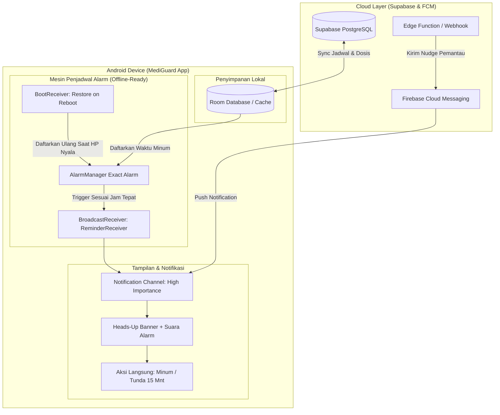
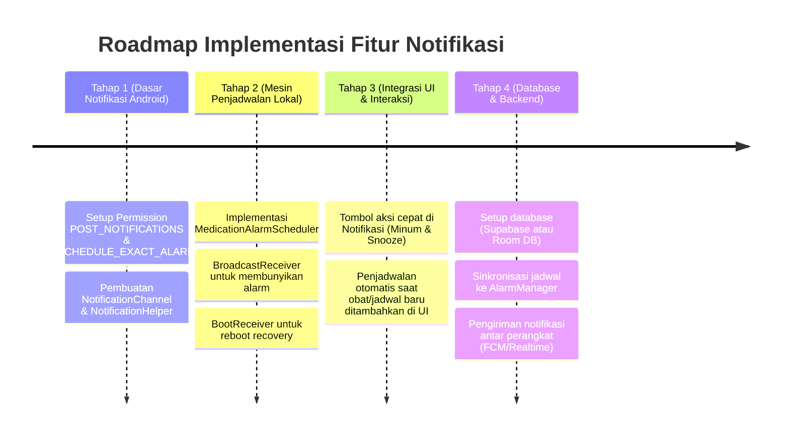

# Rencana Arsitektur & Implementasi: Fitur Notifikasi Jadwal Obat MediGuard

Dokumen ini merinci kebutuhan persiapan sistem, pemilihan database (termasuk kelayakan **Supabase**), serta arsitektur teknis untuk membangun fitur notifikasi pengingat jadwal obat di Android.

---

## 1. Apakah Supabase Bisa Digunakan?

**Jawaban: Sangat Bisa dan Sangat Direkomendasikan.**

Supabase adalah platform *Backend-as-a-Service* (BaaS) berbasis **PostgreSQL** yang menyediakan kapabilitas lengkap yang dibutuhkan MediGuard:

| Fitur Supabase | Manfaat untuk MediGuard & Notifikasi |
| :--- | :--- |
| **PostgreSQL Database** | Menyimpan tabel relasional: `users`, `rooms`, `medications`, `schedules`, `dose_events`, dan `device_tokens`. Mendukung tipe data `TIME`, `TIMESTAMP WITH TIME ZONE`, dan `JSONB`. |
| **Realtime Engine (WebSockets)** | Menyinkronkan status pengobatan secara instan antara Pasien dan Pemantau tanpa perlu polling berkala 2.5 detik. |
| **Edge Functions / Webhooks** | Menjalankan logika backend serverless (misal: mengirim Push Notification via FCM saat Pemantau menekan tombol *"Ingatkan Pasien"* atau saat jadwal obat dibuat). |
| **Storage Bucket** | Menggantikan folder lokal `server/uploads` untuk menyimpan foto bukti konsumsi obat dengan URL aman dan CDN. |
| **pg_cron / Database Triggers** | Dapat menjadwalkan pengecekan dosis jatuh tempo secara otomatis di level database. |
| **Supabase Kotlin SDK** | Tersedia pustaka resmi untuk Android/Kotlin (`postgrest-kt`, `realtime-kt`, `storage-kt`, `auth-kt`). |

---

## 2. Arsitektur Notifikasi Medis: Dua Layer Wajib

Dalam aplikasi medis pengingat obat, notifikasi **tidak boleh hanya mengandalkan koneksi internet**. Pasien harus tetap menerima notifikasi tepat waktu meskipun sedang berada di luar jangkauan sinyal (offline) atau saat aplikasi ditutup.

Oleh karena itu, arsitektur terbaik adalah **Dual-Layer Architecture**:

1. **Layer 1: Local Exact Alarm (Offline-First / AlarmManager)**
   * **Fungsi:** Membunyikan notifikasi jadwal obat harian secara tepat menit (misal: 08:00, 14:00) tanpa memerlukan koneksi internet.
   * **Teknologi:** Android `AlarmManager.setExactAndAllowWhileIdle()` + `BroadcastReceiver` + `NotificationManagerCompat`.
2. **Layer 2: Remote Push Notification (Supabase + FCM)**
   * **Fungsi:** Menerima notifikasi *real-time* lintas perangkat (misal: Pemantau menekan *"Ingatkan Pasien"*, atau Pasien mengirim laporan konsumsi obat).
   * **Teknologi:** Supabase Webhook/Edge Function memanggil Google Firebase Cloud Messaging (FCM).

---

## 3. Apa Saja yang Perlu Dipersiapkan?

### A. Persiapan Sisi Android (Client-Side)

1. **Perizinan (*Permissions*) di `AndroidManifest.xml`:**
   * `android.permission.POST_NOTIFICATIONS` (Wajib untuk Android 13 / API 33 ke atas).
   * `android.permission.SCHEDULE_EXACT_ALARM` & `android.permission.USE_EXACT_ALARM` (Wajib agar alarm berbunyi persis pada menit yang ditentukan, bahkan saat Doze Mode).
   * `android.permission.RECEIVE_BOOT_COMPLETED` (Wajib agar alarm didaftarkan ulang setelah ponsel di-*restart*).
   * `android.permission.VIBRATE` (Getaran notifikasi).

2. **Komponen Sistem Android yang Harus Dibuat:**
   * **`NotificationHelper`**: Membuat `NotificationChannel` dengan tingkat *Importance High*, suara alarm, getar, dan *heads-up banner*.
   * **`MedicationAlarmScheduler`**: Helper class untuk menjadwalkan atau membatalkan alarm di `AlarmManager` berdasarkan objek jadwal obat.
   * **`MedicationReminderReceiver` (`BroadcastReceiver`)**: Menangkap event alarm dari sistem dan membangun notifikasi dengan tombol aksi langsung:
     * Tombol 1: **"Sudah Minum"** (membuka kamera/form lapor).
     * Tombol 2: **"Tunda 15 Menit"** (otomatis menjadwalkan *snooze*).
   * **`BootCompletedReceiver` (`BroadcastReceiver`)**: Mendengarkan `ACTION_BOOT_COMPLETED` agar semua jadwal obat yang belum lewat otomatis dijadwalkan kembali ke `AlarmManager`.
   * **Runtime Permission Handler di Compose**: Meminta izin notifikasi dan izin alarm secara ramah kepada pengguna saat pertama kali membuka dashboard.

3. **Dependensi Gradle Baru:**
   * `androidx.work:work-runtime-ktx` (opsional untuk background sync berkala).
   * `io.github.jan-tennert.supabase:postgrest-kt`, `realtime-kt`, `storage-kt` (jika mengadopsi Supabase).
   * `com.google.firebase:firebase-messaging-ktx` (jika menggunakan Push Notification FCM).

---

### B. Persiapan Sisi Database & Backend (Supabase)

1. **Skema Database Relasional:**
   * `profiles`: Data pengguna (`id`, `name`, `email`, `role`, `fcm_token`).
   * `rooms` & `room_members`: Relasi pemantau dan pasien.
   * `medications`: Daftar obat (`id`, `room_id`, `name`, `dosage`, `instructions`).
   * `schedules`: Jadwal (`id`, `medication_id`, `frequency`, `times[]` text array format `["08:00", "20:00"]`, `is_active`).
   * `dose_events`: Instance jadwal spesifik per tanggal (`id`, `scheduled_time`, `status`, `photo_url`, `taken_at`).
   * `audit_logs` & `notifications`: Catatan jejak rekam medis dan histori notifikasi.

2. **Kebijakan Keamanan (Row Level Security / RLS):**
   * Mengatur aturan agar pasien hanya bisa membaca datanya sendiri dan pemantau yang sudah disetujui (`status = APPROVED`) yang berhak melihat jadwal & aktivitas pasien.

3. **Storage Bucket di Supabase:**
   * Bucket `medication-proofs` dengan akses publik atau *signed URL* untuk menyimpan foto bukti minum obat.

---

## 4. Opsi Pendekatan Implementasi (Trade-offs)

Terdapat 3 opsi pendekatan yang dapat dipilih sesuai dengan tenggat waktu dan cakupan proyek:

| Opsi | Deskripsi | Kelebihan | Pertimbangan |
| :--- | :--- | :--- | :--- |
| **Opsi 1: Local Exact Alarm Only (Rekomendasi Cepat / Fokus PAPB)** | Menggunakan `AlarmManager` + data jadwal yang sudah ada di aplikasi. Notifikasi pengingat berbunyi lokal di perangkat pasien. | Paling cepat diimplementasikan, tidak memerlukan setup akun cloud baru, 100% offline-ready, sangat sesuai untuk demo aplikasi mobile. | Belum ada push notifikasi jarak jauh dari perangkat pemantau jika kedua HP terpisah jaringan internet luas. |
| **Opsi 2: Local Alarm + Supabase Backend** | Mengganti backend `server.js` dengan Supabase. Jadwal disimpan di Supabase, disinkronkan ke lokal, dan dibunyikan via `AlarmManager`. | Arsitektur modern standar industri, database cloud permanen, fitur realtime sinkronisasi otomatis, penyimpanan foto di cloud. | Butuh migrasi API client dari `server.js` ke Supabase Kotlin SDK dan konfigurasi tabel di dashboard Supabase. |
| **Opsi 3: Full-Stack (Local Alarm + Supabase + FCM Push)** | Semua fitur di Opsi 2 ditambah integrasi Google Firebase Cloud Messaging untuk push notification jarak jauh. | Solusi paling lengkap dan siap produksi. Pemantau bisa menekan *"Ingatkan"* dan HP pasien berbunyi dari jarak jauh. | Perlu konfigurasi Firebase Console (`google-services.json`), Supabase Edge Function / Node.js trigger, dan setup FCM token. |

---

## 5. Rencana Tahapan Eksekusi

1. **Tahap 1: Setup Notifikasi & Izin Android**
   * Tambahkan permission di `AndroidManifest.xml`.
   * Buat class `NotificationHelper` dengan channel `channel_medication_reminder` (Importance High, suara alarm default/custom, getar).
   * Buat UI prompt permintaan izin di Jetpack Compose.
2. **Tahap 2: Implementasi `AlarmManager` & Receivers**
   * Buat `MedicationAlarmScheduler.kt` untuk konversi string waktu (misal `"08:00"`) menjadi milidetik waktu alarm harian (`Calendar`/`LocalTime`).
   * Buat `MedicationReminderReceiver.kt` untuk menangkap alarm dan menampilkan banner notifikasi.
   * Buat `BootReceiver.kt` agar alarm tidak hilang saat HP mati/restart.
3. **Tahap 3: Menghubungkan ke Alur Pengobatan & Snooze**
   * Panggil `scheduler.schedule()` saat jadwal obat baru ditambahkan atau saat aplikasi dimuat.
   * Sambungkan aksi tombol notifikasi "Tunda" langsung ke fungsi `snoozeDose()` yang sudah ada di repository.
4. **Tahap 4: Integrasi Database (Supabase)**
   * Inisialisasi Supabase project & buat skema tabel.
   * Hubungkan Supabase client ke `MediGuardRepository`.
   * Setup FCM untuk notifikasi remote dari Pemantau.

---

## 6. Verifikasi & Pengujian

* **Uji Izin:** Uji runtime permission dialog di Android 13+ (apakah izin notifikasi dan exact alarm diminta dengan benar).
* **Uji Alarm Waktu Nyata:** Jadwalkan alarm 1 menit ke depan, kunci layar/tutup aplikasi, dan pastikan notifikasi muncul dengan suara/getar tepat waktu.
* **Uji Tombol Aksi:** Tekan tombol "Tunda 15 Menit" pada banner notifikasi dan pastikan alarm baru terjadwal kembali.
* **Uji Reboot:** Nyalakan ulang perangkat/emulator dan verifikasi bahwa `BootReceiver` mendaftarkan ulang jadwal yang aktif.
* **Uji Offline:** Matikan Wi-Fi dan data seluler, pastikan notifikasi pengingat lokal tetap berbunyi normal.
